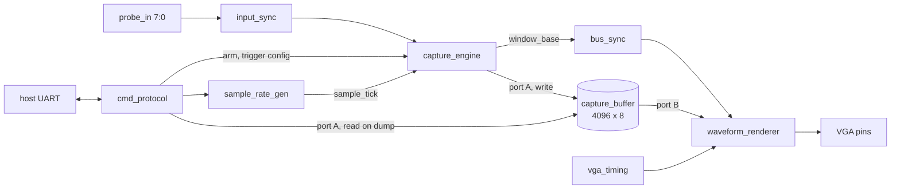

# UART Controlled Logic Analyzer on an FPGA


A logic analyzer built in Verilog for the Real Digital Blackboard (Zynq-7000, XC7Z007S). Arm it, pick a trigger, and it watches the probe pins at a sample rate you choose, catches the event, and shows the capture two ways at once: as a live waveform on a VGA monitor, and as raw samples pulled back over UART by a small Python script.

This is the second project on this board, after my [UART to VGA terminal](https://github.com/HThakkar23/uart-vga-terminal). That one built the UART core and the VGA pipeline. This one reuses both unchanged and spends the new work on the interesting part: a capture engine, a ring buffer that fits in one block RAM tile, a real pre-trigger and post-trigger window, and a binary command protocol over the same serial link.

<!-- Add a photo of the VGA waveform here, for example:  -->

## Quick Start

**Needs:** Vivado (2019.2 or newer), a Real Digital Blackboard, a USB to TTL serial adapter, a monitor with VGA, something to probe, and `pyserial` on the host (`pip install pyserial`).

```
git clone https://github.com/HThakkar23/logic-analyzer
```

In the Vivado Tcl console:

```
cd logic-analyzer
source scripts/create_project.tcl
```

Run synthesis, implementation and bitstream generation, then program the board. Wire the serial adapter to PMOD header JC, connect your probes, and run:

```
python host/la_client.py --port COM5 --rate 1000000 --channel 0 --mode rising
```

The board arms, waits for a rising edge on channel 0, fills the rest of the buffer, and the VGA monitor shows the waveform. The script then pulls all 4096 samples back, writes `capture.csv`, and prints a small ASCII view. Use `--help` for the trigger channel, trigger mode, timeout and which channels to print.

Check the `NEEDS VERIFICATION` blocks in `constr/blackboard_la.xdc` before you build. Details are in the pin notes below and in [SETUP.md](SETUP.md).

## Why a ring buffer with a pre-trigger window

A logic analyzer that only starts recording when it sees the trigger can show you what happened after the event, but not what led up to it, which is usually the more useful half. So the buffer here is a ring. Once armed it records continuously and overwrites the oldest sample with each new one. When the trigger fires it keeps recording for exactly as many samples as it already had before the trigger, then stops. The result is a window centered on the sample that caused the trigger.

The buffer depth is a power of two, so the write pointer wrapping around is just unsigned overflow. There is no modulo arithmetic anywhere in the address path.

## How the design fits together



Two clock domains again: a 100 MHz system domain runs the UART, the command parser, the sample rate divider and the capture engine. A 25 MHz pixel domain runs the VGA timing and the waveform renderer.

The part I spent the most time thinking about is `window_base`, the ring address of the oldest sample in a finished capture. It has to get from the system domain to the pixel domain. In the terminal project I used a toggle synchronizer for the scroll position. That only works because the scroll position moves by a fixed step. Here a new capture can leave `window_base` at any of 4096 addresses with no relation to the last one, so a toggle scheme does not fit. It goes through a plain double flop synchronizer instead (`bus_sync.v`). A multi-bit value crossed this way can show a torn value if its bits do not all settle on the same edge. Here that only costs one wrong looking video frame right after a capture finishes, and the next frame is correct, so a slower handshake was not worth it.

Port A of the buffer is shared by two system domain clients that never need it at the same time: the capture engine writes into it while filling, and the command parser reads it back during a dump. Port B belongs to the renderer on the pixel clock, so the live display never competes with either of them.

### What the VGA shows

The capture is 4096 samples but the screen is 640 pixels wide. Instead of squeezing 4096 samples into 640 columns, the renderer shows a fixed 640 sample window, one sample per pixel column, centered on the trigger sample (320 before it and 320 after). Because `window_base` already points at the oldest sample, sliding to any point in the ring is just an addition that wraps for free.

## The numbers

These come from the Python scripts in `scripts/`.

**Sample rate** (`sample_rate_calc.py`). The divider is set by the host at runtime, so any whole divisor of the 100 MHz clock works:

```
 target rate |  divider |  actual rate |   error |  sample period |  full window
--------------------------------------------------------------------------------
         100 |  1000000 |        100.0 |  +0.00% |      10.000 ms |     40.960 s
       1,000 |   100000 |      1,000.0 |  +0.00% |       1.000 ms |      4.096 s
      10,000 |    10000 |     10,000.0 |  +0.00% |     100.000 us |   409.600 ms
     100,000 |     1000 |    100,000.0 |  +0.00% |      10.000 us |     40.960 ms
   1,000,000 |      100 |  1,000,000.0 |  +0.00% |       1.000 us |      4.096 ms
  10,000,000 |       10 | 10,000,000.0 |  +0.00% |     100.000 ns |    409.600 us
  50,000,000 |        2 | 50,000,000.0 |  +0.00% |      20.000 ns |     81.920 us
```

Every row is exact because 100 MHz divides evenly into each target. The fastest setting is a divider of 1, which is one sample per system clock, 100 MSa/s. At that rate the whole buffer covers 40.96 microseconds. At the slow end, 1 kHz stretches the buffer to just over 4 seconds, long enough to catch something like a button bounce.

**Why 4096 samples** (`capture_budget.py`):

```
  depth |     bits | RAMB18 tiles | RAMB36 tiles | tile fill
------------------------------------------------------------
    512 |     4096 |            1 |            1 |     11.1%
   1024 |     8192 |            1 |            1 |     22.2%
   2048 |    16384 |            1 |            1 |     44.4%
   4096 |    32768 |            2 |            1 |     88.9%  <- chosen
   8192 |    65536 |            4 |            2 |     88.9%
  16384 |   131072 |            8 |            4 |     88.9%
```

4096 samples of 8 bits is the biggest buffer that still fits in one RAMB36 tile, 88.9% full. Anything deeper needs at least two tiles, so the cost doubles for a window that is not twice as useful. One tile is 2.0% of the 50 on the XC7Z007S.

**Dump time** (`dump_timing_calc.py`). Pulling 4096 bytes back over UART at 10 bits per byte:

```
    baud |    dump time |  dumps / sec
--------------------------------------
   9,600 |      4.267 s |          0.2
  38,400 |      1.067 s |          0.9
  57,600 |   711.111 ms |          1.4
 115,200 |   355.556 ms |          2.8  <- board default
 230,400 |   177.778 ms |          5.6
 460,800 |    88.889 ms |         11.2
 921,600 |    44.444 ms |         22.5
```

These are calculated from the frame size and the baud rate, not stopwatch readings from a run on the board.

Add the fill time at each sample rate and you get the arm to dump round trip:

```
 sample rate |    fill time |    dump time |   round trip | captures / sec
--------------------------------------------------------------------------
       1,000 |      4.096 s |   355.556 ms |      4.452 s |           0.22
      10,000 |   409.600 ms |   355.556 ms |   765.156 ms |           1.31
     100,000 |    40.960 ms |   355.556 ms |   396.516 ms |           2.52
   1,000,000 |      4.096 ms |   355.556 ms |   359.652 ms |           2.78
  10,000,000 |   409.600 us |   355.556 ms |   355.965 ms |           2.81
```

At low sample rates the fill time dominates because the instrument is just waiting for real time to pass. Past about 1 MSa/s the fill is almost instant and the fixed UART dump takes over, so the round trip barely changes even as the sample rate climbs 10x. The way to lower that floor is a faster host link.

## An off-by-one I caught on paper

The sample that actually satisfies the trigger is not free. It counts as the first sample of the post-trigger half, same as every sample after it. My first draft of the capture FSM started the post-trigger counter at 0 on the tick the trigger fired. That undercounts the window by one sample and leaves `window_base` pointing at the wrong address once the ring is full.

I caught it by working a tiny case by hand before trusting the real design: `DEPTH = 8`, `PRETRIGGER = 4`, with the level trigger firing on exactly the 5th sample. For the total to come out to exactly 8 writes, the trigger tick's own write has to seed the post-trigger counter at 1. The comment at the top of `capture_engine.v` has the full reasoning, and `tb_capture_engine.v` checks that exact case: every one of the 8 addresses written exactly once, `done` after the right number of ticks, and `window_base` landing on address 0.

## Host command protocol

All settings go over the same UART as the dump. With 8 channels, a 16 bit divider and a trigger mode to pick, there are far too many combinations for a few board switches.

| Opcode | Name | Payload | Reply |
| --- | --- | --- | --- |
| `0x01` | ARM | none | ACK or NACK |
| `0x02` | SET_DIVIDER | 2 bytes, MSB first | ACK or NACK |
| `0x03` | SET_TRIGGER | 1 byte: channel in bits 7:5, mode in bits 4:3 | ACK or NACK |
| `0x04` | STATUS | none | 1 byte: bit 0 armed, bit 1 triggered, bit 2 done |
| `0x05` | DUMP | none | 4096 raw bytes, no framing |

Trigger modes: rising edge, falling edge, level high, and free run, which fires as soon as the ring is primed and is handy for just watching what is happening right now.

| LED | Meaning |
| --- | --- |
| `led[0]` | armed |
| `led[1]` | triggered |
| `led[2]` | done, capture ready to dump |
| `led[3]` | heartbeat, about 1 Hz |
| `led[4]` | toggles every sample tick, so you can see the sample rate |
| `led[7:5]` | trigger channel |
| `led[9:8]` | trigger mode |

## Simulation

I ran all three testbenches with Icarus Verilog 12 and all three print `PASS`:

| Testbench | What it checks |
| --- | --- |
| `tb_sample_rate_gen` | one tick every `divider` clocks for dividers 0, 1, 4 and 1000 |
| `tb_capture_engine` | the DEPTH=8, PRETRIGGER=4 case above: 8 unique writes, correct `window_base` |
| `tb_cmd_protocol` | the command parser end to end over a simulated UART |

```
iverilog -g2012 -o sim_rate.out rtl/sample_rate_gen.v sim/tb_sample_rate_gen.v && vvp sim_rate.out
iverilog -g2012 -o sim_cap.out rtl/capture_buffer.v rtl/capture_engine.v sim/tb_capture_engine.v && vvp sim_cap.out
iverilog -g2012 -o sim_cmd.out rtl/capture_buffer.v rtl/capture_engine.v rtl/sample_rate_gen.v rtl/cmd_protocol.v rtl/uart_rx.v rtl/uart_tx.v rtl/baud_tick_gen.v sim/tb_cmd_protocol.v && vvp sim_cmd.out
```

One note on the testbenches: the first versions drove inputs exactly on the rising clock edge with blocking assignments, which races the design under test in some simulators. They now drive stimulus on the falling edge so the result does not depend on the simulator's scheduling.

## Pin notes

The Blackboard's PMOD header JC only has 8 signal pins and 2 of them are the UART, so only **6 probe channels (`probe_in[0]` to `probe_in[5]`) are wired** in the constraints file. The capture engine, the buffer and the VGA display are built for 8 channels. To use channels 6 and 7, give them pins on a free PMOD header, or leave them unused.

Also check the VGA block in `constr/blackboard_la.xdc`. One pin in it (`vga_red[0]`) is marked because a verified reference lists that package pin as an onboard RGB LED. Confirm it against your board's master XDC.

## Repository structure

```
logic-analyzer/
├── constr/
│   └── blackboard_la.xdc        # pins, two blocks need checking
├── host/
│   └── la_client.py             # Python command and dump client (pyserial)
├── rtl/
│   ├── logic_analyzer_top.v     # top level
│   ├── input_sync.v             # two flop synchronizer on each probe
│   ├── sample_rate_gen.v        # runtime programmable sample tick
│   ├── capture_engine.v         # arm, pre-fill, trigger, post-fill, done
│   ├── capture_buffer.v         # 4096x8 true dual-port block RAM
│   ├── cmd_protocol.v           # host commands and the dump
│   ├── bus_sync.v               # carries window_base to the pixel domain
│   ├── waveform_renderer.v      # 8 channel waveform on VGA
│   ├── vga_timing.v             # 640x480 at 60 Hz
│   ├── led_display.v            # status LEDs
│   ├── uart_rx.v  uart_tx.v  baud_tick_gen.v
│   └── reset_sync.v
├── scripts/
│   ├── create_project.tcl
│   ├── sample_rate_calc.py
│   ├── capture_budget.py
│   └── dump_timing_calc.py
├── sim/
│   ├── tb_sample_rate_gen.v
│   ├── tb_capture_engine.v
│   └── tb_cmd_protocol.v
└── SETUP.md
```

## Areas for improvement

- **Two stage trigger.** Require a short sequence of conditions instead of a single edge or level.
- **A faster host link.** At 115200 baud the 355.6 ms dump sets the floor on capture rate. A higher baud rate lowers it, at the cost of a more carefully tuned baud generator on both ends.
- **Protocol decoding.** Decode SPI or I2C from the captured bytes on the host side instead of leaving raw channel bits.
- **All 8 channels on pins.** Move two probes to a second PMOD header.
- **Adjustable pre-trigger.** The split is fixed at half the buffer. Making it a command would let you look further before or after the event.

## References and resources

- Real Digital Blackboard: https://www.realdigital.org/hardware/blackboard
- AMD 7 Series FPGAs Memory Resources (UG473), for the RAMB36 and RAMB18 sizes and true dual-port behavior
- Clifford Cummings, "Clock Domain Crossing (CDC) Design and Verification Techniques Using SystemVerilog" (SNUG 2008), for the multi-bit synchronizer tradeoffs
- My earlier project this builds on: https://github.com/HThakkar23/uart-vga-terminal